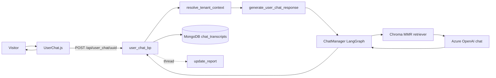
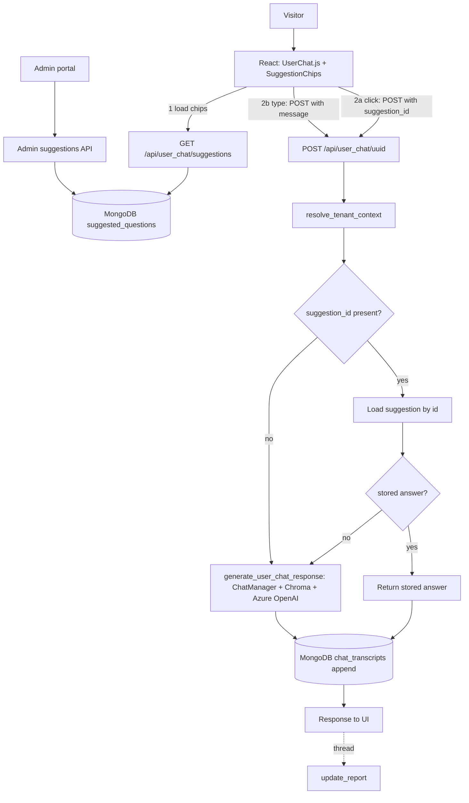
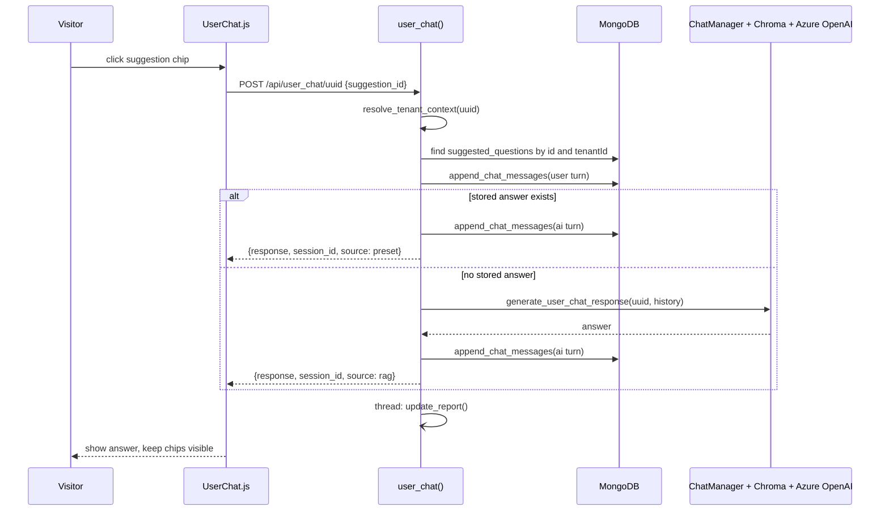

# Guided Chatbot: Suggested Questions (HLD and Implementation Design)

- **Document ID:** CAFAI-HLD-SUGGESTED-QUESTIONS
- **Title:** Guided chatbot with suggested question buttons for the four Caze Labs modules
- **Author:** Anusha Kattimani
- **Version:** 0.1 (Draft for review)
- **Status:** DRAFT. Open questions in section 9 need confirmation.
- **Target repository:** `cafai-leadagent` (`caze-bizcon-ai` Flask backend, `caze-bizcon-ui` React frontend)

---

## 1. Executive Summary and Objectives

### 1.1 Problem
Today a visitor must type every question into the chatbot. Many visitors do not know what to ask about Caze Labs.

### 1.2 Goal
Add an Amazon-style guided experience where the chatbot shows clickable suggested questions grouped under the four modules:

- CostSense
- HireSense
- AISense
- SecuritySense

The visitor can click a suggestion or keep typing as before.

### 1.3 Objectives
1. Show suggested questions per module in the chat window.
2. Answer a clicked suggestion quickly and consistently.
3. Keep the existing typed-question RAG flow unchanged.
4. Store every clicked or typed turn in the existing chat transcript so lead scoring keeps working.
5. Let admins manage the suggested questions without a code change.

### 1.4 Non-goals
- No change of the backend framework (it stays Flask).
- No new LLM or vector database.
- The four modules are knowledge categories, not four separate AI models.

---

## 2. Current Architecture (As Implemented)

| Layer | What exists today |
|---|---|
| Frontend | `UserChat.js` calls `GET /api/user_chat/<uuid>` to load history and `POST /api/user_chat/<uuid>` with `{message}` to send. |
| Backend | Flask. `user_chat_bp` (`core/user_chat.py`) with `resolve_tenant_context()` for tenant and guest sessions. |
| Chat logic | `generate_user_chat_response()` in `core/chat_logic.py` builds a `ChatManager` and calls `invoke_agent()`. |
| Agent | `ChatManager` (`core/chat_manager.py`) runs a LangGraph with one node, `retrieve_and_respond`. |
| Retrieval | Chroma, one collection per tenant (`tenant_<id>`), MMR retriever with `k=5`, `fetch_k=20`, `lambda_mult=0.7`. Query is built from the last 3 user messages. |
| LLM | Azure OpenAI chat and embeddings, created in `setup_llm_and_embeddings()` (`core/settings.py`), temperature 0.1. |
| Storage | MongoDB collections `leads`, `reports`, `chat_transcripts`, `dashboard_events`, `config`, plus GridFS. |
| Background work | After each reply a daemon thread runs `update_report()` for summary, Hot/Warm/Cold status, demo and meeting flags. |
| Deployment | Docker Compose: `bizcon-app` (port 5000), `bizcon-chat` (5005 to 5001), `bizcon-mongodb`, `bizcon-chromadb`, `bizcon-keycloak`, with nginx in front. |

### 2.1 Current flow



---

## 3. Proposed Architecture

### 3.1 Idea
Add a **suggestion path** beside the existing **typed path**. Both paths go through the same endpoint, so history, tenant handling and lead scoring stay in one place.



### 3.2 Design decisions

| # | Decision | Reason |
|---|---|---|
| D1 | Keep Flask. | The existing backend is Flask; no reason to introduce a second framework. |
| D2 | Reuse `POST /api/user_chat/<uuid>` and add an optional `suggestion_id` field. | Existing history, guest sessions and lead scoring keep working with no duplicate code. |
| D3 | Store suggestions in a new Mongo collection, not in code. | Admins can edit questions without a deployment. |
| D4 | A suggestion may have a stored answer. If it has none, it goes through RAG. | Stored answers are fast and predictable; RAG keeps answers grounded in uploaded company documents. |
| D5 | Modules are a field (`module`) on each suggestion, not separate services. | The four modules are knowledge categories. |
| D6 | Suggestions are tenant-scoped with a `default` fallback. | Matches how Chroma collections and reports are already tenant-scoped. |

---

## 4. Data Layer (MongoDB)

### 4.1 New collection: `suggested_questions`

| Field | Type | Notes |
|---|---|---|
| `_id` | ObjectId | Returned to the UI as `id` (string). |
| `tenantId` | string | Same tenant id used by `reports`. `default` for shared suggestions. |
| `module` | string | One of `CostSense`, `HireSense`, `AISense`, `SecuritySense`. |
| `question` | string | Text shown on the button. |
| `answer` | string or null | Optional stored answer. `null` means use RAG. |
| `order` | int | Display order inside the module. |
| `isActive` | bool | Hidden when false. |
| `createdAt`, `updatedAt` | datetime (UTC) | Audit. |

### 4.2 Indexes
```python
# added in MongoStorage._ensure_indexes()
self.suggested_questions.create_index([("tenantId", 1), ("module", 1), ("isActive", 1), ("order", 1)])
```

### 4.3 Existing collections: no schema change
Each clicked suggestion is stored in `chat_transcripts` as a normal turn, so no new field is required:

```json
{ "role": "user", "message": "<question text>", "time": "2026-11-19T10:00:00Z" }
```

### 4.4 Seed data
A script `scripts/seed_suggested_questions.py` inserts a starting set of questions for the four modules. Question and answer text must come from Caze Labs (see open question Q3).

---

## 5. API Design

### 5.1 `GET /api/user_chat/suggestions`
Returns active suggestions for the visitor's tenant, grouped by module.

| Item | Value |
|---|---|
| Query params | `uuid` (optional session id, used to resolve the tenant), `module` (optional filter) |
| Auth | Same public access as the chat endpoint (the visitor is anonymous or arrives by link). |
| Success 200 | See below. |
| Errors | `400` invalid or expired chat link, `500` database error. |

```json
{
  "modules": [
    {
      "name": "CostSense",
      "suggestions": [
        { "id": "665f...", "question": "What does CostSense do?" }
      ]
    }
  ]
}
```

> Implementation note: the existing route `/<uuid>` would also match this path. Flask prefers static routes over dynamic ones, so `/suggestions` wins, the same way `/transcript/<uuid>` already coexists. This must be covered by a test.

### 5.2 `POST /api/user_chat/<uuid>` (extended)
Request body gains one optional field.

```json
{ "message": "free text", "suggestion_id": "665f..." }
```

| Case | Behaviour |
|---|---|
| Only `message` | Unchanged typed flow. |
| `suggestion_id` valid, answer stored | Return stored answer, no LLM call. |
| `suggestion_id` valid, no answer | Use the suggestion's `question` as the message and run the normal RAG flow. |
| `suggestion_id` invalid or inactive | Fall back to `message` if present, else `400`. |

Response keeps the current shape and adds a source marker:

```json
{ "response": "...", "session_id": "...", "source": "preset" }
```
`source` is `preset` or `rag`.

### 5.3 Admin endpoints (new, in `core/admin.py`)
Follow the existing `/api/{API_KEY_PATH}/admin/...` pattern.

| Method | Path | Purpose |
|---|---|---|
| `GET` | `/api/{API_KEY_PATH}/admin/suggestions` | List all suggestions. |
| `POST` | `/api/{API_KEY_PATH}/admin/suggestions` | Create one. |
| `PUT` | `/api/{API_KEY_PATH}/admin/suggestions/<id>` | Update question, answer, order or `isActive`. |
| `DELETE` | `/api/{API_KEY_PATH}/admin/suggestions/<id>` | Delete one. |

Validation: `module` must be one of the four names; `question` required, trimmed, maximum 200 characters; `answer` maximum 2000 characters.

---

## 6. Detailed Flows

### 6.1 Suggestion click



### 6.2 Typed question
Unchanged from section 2.1. `source` is returned as `rag`.

### 6.3 Loading the chips
1. `UserChat.js` finishes the existing history load (`GET /api/user_chat/<uuid>`).
2. It then calls `GET /api/user_chat/suggestions?uuid=<session_id>`.
3. The module tabs and chips render above the input box.
4. If the call fails, the chat works normally with no chips (graceful degradation).

---

## 7. Code Changes Required

| File | Change |
|---|---|
| `caze-bizcon-ai/pkg/core/mongo_storage.py` | Add `self.suggested_questions` collection, index in `_ensure_indexes()`, methods `get_suggestions(tenant_id, module=None)`, `get_suggestion_by_id(id, tenant_id)`, `create_suggestion()`, `update_suggestion()`, `delete_suggestion()`. |
| `caze-bizcon-ai/pkg/core/user_chat.py` | New `GET /suggestions` route. In `user_chat()` POST branch, read `suggestion_id`, resolve it, and either return the stored answer or substitute its `question` as the message. Add `source` to the response. |
| `caze-bizcon-ai/pkg/core/admin.py` | Four admin CRUD routes (section 5.3) with validation. |
| `caze-bizcon-ai/pkg/app_chat.py` | No new blueprint needed (it already registers `user_chat_bp`); verify the new route is reachable on port 5005. |
| `caze-bizcon-ui/pkg/src/components/UserChat.js` | Fetch suggestions after history loads; render `SuggestionChips`; `sendMessage` accepts an optional `suggestionId` and sends it in the POST body. |
| `caze-bizcon-ui/pkg/src/components/SuggestionChips.js` (new) | Module tabs plus chip buttons. Disabled while `isChatEnded` or `companyInfoMissing`, matching the input box. |
| `scripts/seed_suggested_questions.py` (new) | One-time seed for the four modules. |
| `tests/` | Add cases for click, typed, invalid id, inactive suggestion and route conflict. |

No change to `docker-compose.yml`, Chroma, or Azure settings.

---

## 8. Non-Functional Considerations

### 8.1 Security
- The suggestions endpoint is public like the chat endpoint, so it returns only `id`, `question` and `module`. The stored `answer` is never sent until a chip is clicked.
- Admin routes use the same protection as the other `/api/{API_KEY_PATH}/admin/...` routes.
- Stored answers are plain text. The UI must render them as text, not HTML.
- Stored answers do not pass through the RAG prompt, so the existing prompt-injection sanitising applies only to the RAG path.

### 8.2 Performance and cost
- A stored answer skips retrieval and the LLM call, so it is faster and cheaper than a typed question.
- The suggestions read is one indexed Mongo query.

### 8.3 Lead scoring
- Clicked suggestions are saved as normal user turns, so `update_report()` still sees them for status, demo and meeting detection.
- The existing debounce signal terms (for example "what", "how", "price") apply to the question text.

### 8.4 Failure handling

| Failure | Behaviour |
|---|---|
| Suggestions call fails | Chat works without chips. |
| Invalid or inactive `suggestion_id` | Falls back to `message`, else `400`. |
| Azure OpenAI error on the RAG path | Same handling as typed questions today. |
| `company_info_missing` | Chips disabled with the input box. |

### 8.5 Observability
Log `suggestion_id`, `module` and `source` per request. Optionally record a `suggestion_clicked` dashboard event (this needs a small change in `get_dashboard_metrics()`, so it is out of scope for the first version).

---

## 9. Open Questions (for review)

| # | Question | Impact |
|---|---|---|
| Q1 | Should the suggested questions be fixed presets, or generated by AI from the company documents? | This design assumes presets managed by admins. AI generation would add a generation step and an approval step. |
| Q2 | Should clicked suggestions return a stored answer, or always go through RAG? | This design supports both, chosen per suggestion by whether `answer` is filled. |
| Q3 | Who supplies the question and answer content for each module? | Needed before the seed script can be completed. |
| Q4 | Are the suggestions the same for every tenant, or tenant-specific? | This design supports both with a `default` fallback. |
| Q5 | Should chips also show follow-up suggestions after an answer? | Not in version 0.1; would need a `followUps` field. |

---

## 10. Implementation Plan

1. Add the Mongo collection, index and storage methods.
2. Add the `GET /suggestions` route and the `suggestion_id` handling in `user_chat()`.
3. Add the admin CRUD routes.
4. Build `SuggestionChips` and wire it into `UserChat.js`.
5. Write the seed script and tests.
6. Deploy with Docker Compose and test on the chat port (5005).

---

## 11. Assumptions

- The backend framework is Flask (confirmed from the repository).
- Suggestions are admin-managed presets (Q1 is open).
- This document is based on `user_chat.py`, `chat_logic.py`, `chat_manager.py`, `vector_store.py`, `mongo_storage.py`, `chat_prompts.py`, `settings.py`, `UserChat.js` and `docker-compose.yml`. Authentication middleware and nginx routing were not reviewed and should be checked before implementation.
